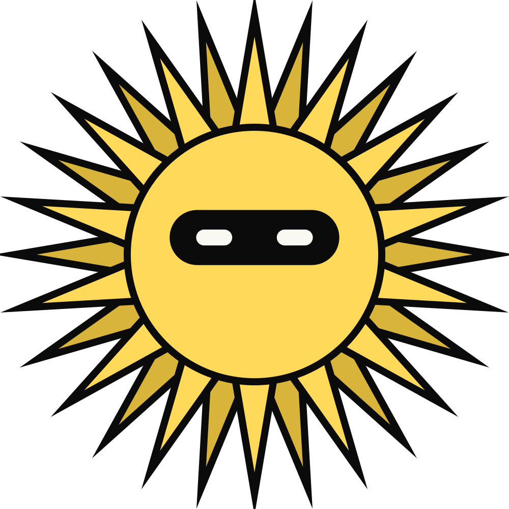
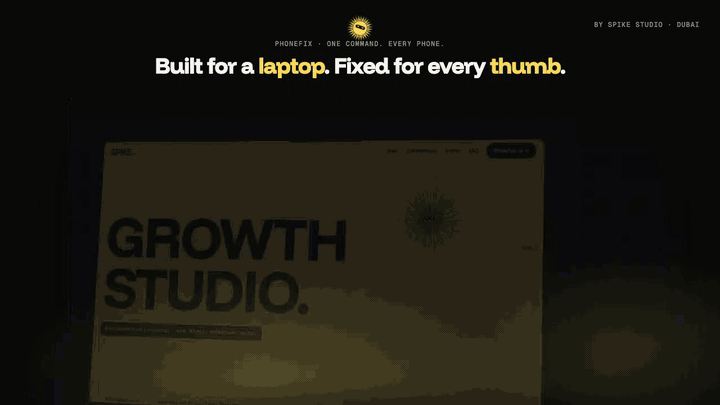
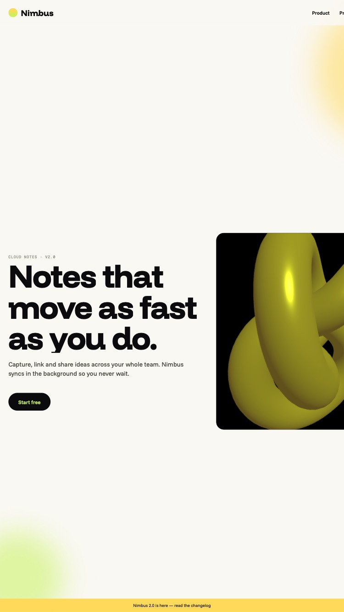

<p align="center">
  <a href="https://spikestudiodxb.com"></a>
</p>

<h1 align="center">phonefix</h1>

<p align="center"><strong>One command. Every phone.</strong></p>

<p align="center">
  Your AI built the site for a laptop. phonefix is a skill for AI coding agents that audits any web app on seven real phone and tablet viewports, auto-fixes what breaks, and proves it with before and after screenshots.
</p>

<p align="center">
  <a href="https://github.com/kp6801-ai/phonefix/blob/main/LICENSE"></a>
  <a href="https://github.com/kp6801-ai/phonefix/stargazers"></a>
  <a href="https://kp6801-ai.github.io/phonefix/"></a>
  <a href="https://spikestudiodxb.com"></a>
</p>

<p align="center">
  Works with <strong>Claude Code</strong> · <strong>Cursor</strong> · <strong>Codex</strong> · <strong>Windsurf</strong> · <strong>GitHub Copilot</strong> · <strong>Gemini CLI</strong>
</p>

<p align="center">
  <a href="https://kp6801-ai.github.io/phonefix/"></a>
</p>

<p align="center"><sub>Our own site, <a href="https://spikestudiodxb.com">spikestudiodxb.com</a>, on a 3D MacBook at 1440px and a 3D iPhone 15 Pro at 393px, each screen a native recording of the page mapped onto the model. Zero severity-4 issues on every phone in the matrix. <a href="https://kp6801-ai.github.io/phonefix/examples/report/report.html">Open the bundled before and after report</a>.</sub></p>

<p align="center">
  
  &nbsp;&nbsp;&nbsp;
  
</p>

<p align="center"><sub>Before and after on iPhone SE. Fifteen issues, then none.</sub></p>

---

## Table of contents

- [Why](#why)
- [Set up in sixty seconds](#set-up-in-sixty-seconds)
- [Install](#install)
  - [Any agent](#any-agent)
  - [Claude Code](#claude-code)
  - [Cursor](#cursor)
  - [Codex](#codex)
  - [Windsurf](#windsurf)
  - [GitHub Copilot](#github-copilot)
  - [Gemini CLI](#gemini-cli)
- [How it works](#how-it-works)
- [What it checks](#what-it-checks)
- [Use the scripts without an agent](#use-the-scripts-without-an-agent)
- [Limits](#limits)
- [Repo layout](#repo-layout)
- [Contributing](#contributing)
- [License](#license)

## Why

Every AI coding tool previews at laptop width. The site looks finished, ships, and then breaks on the phone every customer actually uses: horizontal scroll, 24px buttons, hover menus that never open, a hero that is empty for a whole screen, a Three.js scene rendering seven times more pixels than the phone can show.

phonefix gives the agent what it was missing: real phone viewports, thirty concrete checks, an ordered fix list that goes after root causes, and a verify step that it cannot skip.

## Set up in sixty seconds

1. **Get Playwright once per machine.** It renders the phone viewports.
   ```bash
   npx playwright install chromium webkit
   ```
2. **Add phonefix to your project** with the one-liner for your agent below. Nothing global changes; the skill lands in `.phonefix/` (or `.claude/skills/`) and a 14-line pointer goes into your agent's rules file.
3. **Run your app** (`npm run dev`) or have a static build folder ready.
4. **Tell your agent:** *"make this mobile-perfect"*. It captures a baseline, fixes in order, captures again and opens `phonefix-report/report.html`.
5. **Read the report, spot-check the worst device on a real phone, ship.**

Prefer to download instead of a CLI? Grab the [latest zip](https://github.com/kp6801-ai/phonefix/archive/refs/heads/main.zip), copy `skills/phonefix/` into your project, and paste the block from [adapters/pointer.md.tmpl](adapters/pointer.md.tmpl) into your agent's rules file (replace `{{SKILL_PATH}}` with where you put it).

## Install

### Any agent

```bash
npx skills add kp6801-ai/phonefix
```

The [skills CLI](https://github.com/vercel-labs/skills) installs into whichever agents it finds in the project.

### Claude Code

```bash
npx skills add kp6801-ai/phonefix -a claude-code
```

Or without the CLI, as a global skill:

```bash
git clone https://github.com/kp6801-ai/phonefix ~/.claude/skills/phonefix
```

### Cursor

```bash
curl -fsSL https://raw.githubusercontent.com/kp6801-ai/phonefix/main/skills/phonefix/scripts/install.sh -o phonefix-install.sh && sh phonefix-install.sh --agent cursor
```

Writes `.cursor/rules/phonefix.mdc` and copies the skill into `.phonefix/`.

### Codex

```bash
curl -fsSL https://raw.githubusercontent.com/kp6801-ai/phonefix/main/skills/phonefix/scripts/install.sh -o phonefix-install.sh && sh phonefix-install.sh --agent codex
```

Appends a 14-line block to `AGENTS.md` between `<!-- phonefix:start -->` and `<!-- phonefix:end -->`. Your existing rules stay.

### Windsurf

```bash
curl -fsSL https://raw.githubusercontent.com/kp6801-ai/phonefix/main/skills/phonefix/scripts/install.sh -o phonefix-install.sh && sh phonefix-install.sh --agent windsurf
```

### GitHub Copilot

```bash
curl -fsSL https://raw.githubusercontent.com/kp6801-ai/phonefix/main/skills/phonefix/scripts/install.sh -o phonefix-install.sh && sh phonefix-install.sh --agent copilot
```

### Gemini CLI

```bash
curl -fsSL https://raw.githubusercontent.com/kp6801-ai/phonefix/main/skills/phonefix/scripts/install.sh -o phonefix-install.sh && sh phonefix-install.sh --agent gemini
```

`--agent all` covers every agent in one run. Re-running is safe: the installer refreshes the skill copy and rewrites only its own block. Read the [installer](skills/phonefix/scripts/install.sh) before you run it; it is 50 lines.

## How it works

| Phase | What happens |
|---|---|
| 1. Discover | `detect.mjs` reads the project offline: framework (static, Vite, Next, Nuxt, SvelteKit, Astro), Tailwind, GSAP, ScrollTrigger, Lenis, Three.js, R3F, Spline, dev command and port, where the viewport meta lives. |
| 2. Baseline | Git checkpoint, then `capture.mjs` renders every route on iPhone SE 375, iPhone 15 393, iPhone 15 Pro Max 430, Pixel 7 412, Galaxy S23 360, iPad 768, iPhone 15 landscape, plus a 1440 desktop guard. Five scroll positions per device so scroll-driven animation runs. |
| 3. Audit | Nine categories scored 0 to 4. The agent also opens the two smallest-device screenshots. Eyes catch what the DOM cannot prove. |
| 4. Fix | Thirteen ordered rules, root cause first. Never hides overflow, never disables zoom, never deletes an animation, never changes the desktop design. |
| 5. Verify | Captures again and builds `phonefix-report/report.html`: verdict, score deltas, before/after grid per device, remaining issues with reasons, desktop drift. Passes only with zero severity-4 issues. |

The skill itself is [skills/phonefix/SKILL.md](skills/phonefix/SKILL.md). Deep rules load only when a category fails.

## What it checks

| Category | Checks |
|---|---|
| Viewport | meta missing, no `width=device-width`, zoom disabled, no `viewport-fit=cover` |
| Layout | horizontal overflow with the widest offenders named, fixed px widths over 430, no breakpoints, `100vh`, fixed bars without safe-area, oversized fixed headers, `overflow:hidden` on body |
| Touch | tap targets under 44px, `:hover`-only reveals outside `(hover:hover)`, JS `mouseenter`-only handlers |
| Forms | inputs under 16px (iOS zooms on focus) |
| Type | body under 16px, text under 12px |
| Media | large images without `srcset`, missing dimensions, video without `muted` / `playsinline` / poster |
| Motion | no `prefers-reduced-motion` handling, pinned section taller than the viewport, ScrollTrigger without mobile config, desktop-pixel tweens |
| 3D | canvas DPR over 2, stretched canvas, over 4 megapixels of canvas, too many WebGL contexts |
| Runtime | console errors and uncaught exceptions on load |

Full rules with fixes: [checklist.md](skills/phonefix/references/checklist.md) · scroll animation: [gsap-mobile.md](skills/phonefix/references/gsap-mobile.md) · 3D: [three-mobile.md](skills/phonefix/references/three-mobile.md) · frameworks and Tailwind: [frameworks.md](skills/phonefix/references/frameworks.md) · devices: [devices.md](skills/phonefix/references/devices.md).

## Use the scripts without an agent

```bash
node skills/phonefix/scripts/detect.mjs .
node skills/phonefix/scripts/capture.mjs --url http://localhost:3000 --label before
# fix things
node skills/phonefix/scripts/capture.mjs --url http://localhost:3000 --label after
node skills/phonefix/scripts/report.mjs --title "My app"
```

Static folder instead of a URL: `--dir ./dist`. Several routes: `--routes /,/pricing`. Logged-in pages: `--storage-state auth.json`. Subset of devices: `--devices iphone-se,galaxy-s23`. `checks.js` also runs on its own: paste it into DevTools on a phone-emulated tab.

Try it on the bundled demo: broken input [examples/laptop-only](examples/laptop-only/index.html), fixed output [examples/fixed](examples/fixed/index.html), report [examples/report](examples/report/report.html).

## Limits

Playwright's WebKit and Chromium are emulations, not iOS Safari or Samsung Internet. The URL-bar collapse, the real keyboard and GPU memory limits are not reproduced. The report names the worst device for a hand check on real hardware. Apps that cannot run locally get a source-level audit only. Pages behind login need a Playwright storage state.

## Repo layout

```
skills/phonefix/   SKILL.md, scripts/, references/, assets/   (single source of truth)
adapters/          pointer.md.tmpl + sync.mjs → AGENTS.md, GEMINI.md, .cursor/rules, .windsurfrules, copilot-instructions
landing/           the site at kp6801-ai.github.io/phonefix
examples/          laptop-only/ (broken), fixed/, report/ (before and after)
```

## Contributing

Pull requests are welcome and reviewed by SPIKE Studio before merge. `main` is protected: no direct pushes, no force pushes, every change goes through a reviewed PR. Adding a check is one function in `checks.js` plus one section in `checklist.md` plus a line in both demo pages. See [CONTRIBUTING.md](CONTRIBUTING.md), [SECURITY.md](SECURITY.md) and the [code of conduct](CODE_OF_CONDUCT.md).

## License

[MIT](LICENSE). Copyright 2026 SPIKE Studio. Contributions are accepted under the same license.

<p align="center">
  <br>
  <a href="https://spikestudiodxb.com"></a><br>
  <sub>Built in Dubai by <a href="https://spikestudiodxb.com">SPIKE Studio</a> · <a href="https://instagram.com/spikestudiodxb">@spikestudiodxb</a></sub>
</p>
